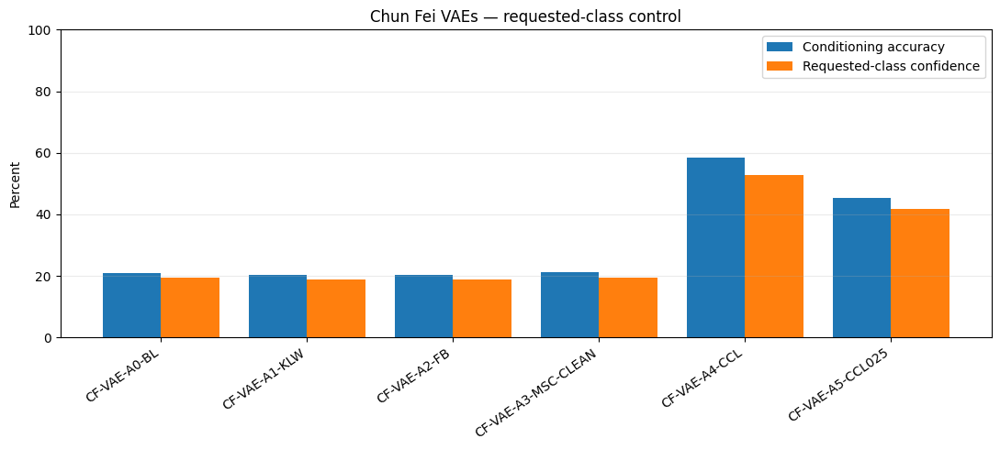
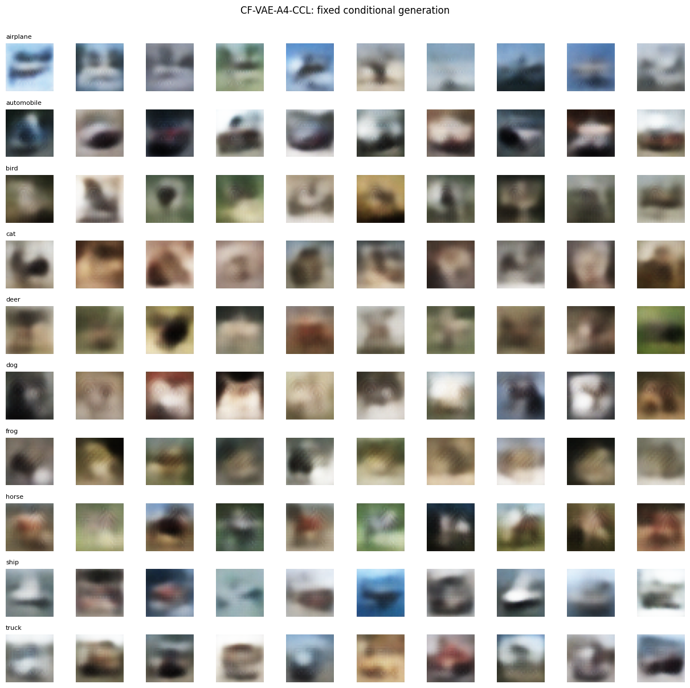
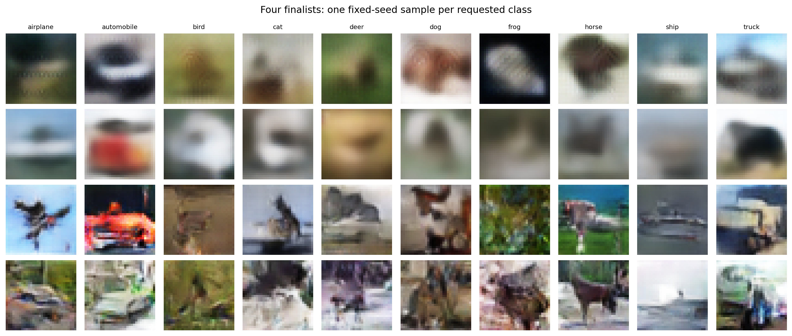

# Conditional VAE and GAN on CIFAR-10

Generating images of a **requested CIFAR-10 class** (airplane, cat, ship…) with conditional variational autoencoders (VAEs) and conditional GANs in TensorFlow/Keras, and measuring both image quality and how well each model follows the requested label.

This was a **pair project** with **You Xuan**:

| | Who |
|---|---|
| Conditional VAE experiment chain (6 controlled runs) | **Hoon Chun Fei** (me) |
| Supporting GAN experiment (equal learning rates vs TTUR) | **Hoon Chun Fei** |
| Main conditional GAN chain (label smoothing, spectral normalisation) and a VAE latent-size study | **You Xuan** (her notebook is not included here) |
| Data split, shared evaluation, final four-model comparison | **Joint** |

## The problem

CIFAR-10 images are tiny (32 × 32) and varied, so a generator has to produce realistic images *and* respect the class it's asked for. Those two goals don't automatically improve together, so each change was tested as a controlled experiment and judged on:
- **FID** (lower is better): how close generated images are to real ones
- **Inception Score** (higher is better)
- **Conditioning accuracy:** how often a separate frozen classifier recognises the requested class

## My VAE experiments

Each run changes one thing from its parent:

| Run | Change | FID ↓ | Conditioning accuracy ↑ | Kept? |
|---|---|---|---|---|
| A0 | Baseline conditional VAE | 185.82 | 20.78% | — |
| A1 | KL warm-up over 20 epochs | 179.37 | 20.32% | ✅ better FID; all 32 latent dimensions used (up from 30) |
| A2 | + free bits (0.125 nats/dimension) | 180.11 | 20.36% | ❌ the floor was almost never active |
| A3 | Label re-injected at 8×8, 16×16 and 32×32 (instead of A2) | **177.88** | 21.18% | ✅ best FID, but class control still weak |
| A4 | + class-consistency loss (weight 1.0) | 200.08 | **58.36%** | ✅ **selected** |
| A5 | + class-consistency loss (weight 0.25) | 193.84 | 45.38% | ❌ gave back too much class control |

**The main finding:** better image statistics did not make the VAE follow the requested class. Better architecture (A3) improved FID but left conditioning accuracy at ~21%. Only an **explicit class-consistency loss** (A4), computed by a separate frozen classifier, nearly tripled it to 58%, at the cost of a worse FID. I chose A4 because the goal is generating a *requested* class.

## My GAN experiment

A single controlled test of the **Two Time-Scale Update Rule (TTUR)**: slowing the generator's learning rate from 2e-4 to 1e-4 while keeping the discriminator at 2e-4.

| Model | FID ↓ | Inception Score ↑ | Conditioning accuracy ↑ |
|---|---|---|---|
| **Equal learning rates (kept)** | **40.50** | **4.57** | **60.34%** |
| TTUR | 46.09 | 4.30 | 54.16% |

TTUR made every metric worse in this setup, and its training curves show the discriminator staying comparatively stronger, so I kept equal learning rates. A published technique isn't automatically an improvement.

## Joint final comparison

Both of us handed over our best VAE and GAN. All four were re-evaluated with one shared protocol: the same frozen classifier, and 5 × 5,000 generated images per model. Because this is a separate evaluation run, the numbers differ slightly from the tables above.

| Finalist | FID ↓ | Inception Score ↑ | Conditioning accuracy ↑ |
|---|---|---|---|
| My VAE (A4) | 200.08 | 2.15 | 57.45% |
| You Xuan's VAE (B1) | 220.32 | 2.16 | 21.73% |
| My GAN (equal LR) | 40.49 | **4.57** | 60.16% |
| **You Xuan's GAN (B4, spectral norm), overall winner** | **40.43** | 4.03 | **72.75%** |

*Rows from top: my VAE (A4), You Xuan's VAE (B1), my GAN (equal LR), You Xuan's GAN (B4).*

- **GANs beat VAEs by a wide margin** on image quality (FID ~40 vs ~200).
- **The two GANs tie on FID.** You Xuan's had much stronger class control, mine a higher Inception Score. Class control decided it, so hers generated the final 1,000 images.
- **Ship was the easiest class** (85% average accuracy across the four models), and **dog the hardest** (32%), often mistaken for cat.

## What I learned

- Image realism and class control are different goals. Improving one can hurt the other, so both need their own metric.
- Test one change at a time and keep the negative results (free bits, TTUR). They're as informative as the wins.
- Use an independent judge. The classifier that trained A4's class loss was kept separate from the one that scored all models, so the result isn't circular.

## Repository contents

| Path | What it is |
|---|---|
| `notebooks/conditional_vae_gan_chunfei.ipynb` | My VAE chain and GAN experiment, with all outputs |
| `notebooks/shared_final_evaluation.ipynb` | The joint four-finalist evaluation, with all outputs |
| `results/` | Metrics (FID, IS) and training histories for my runs |
| `weights/` | My selected VAE and GAN, and the shared evaluation classifier |

The notebooks keep their outputs, so every chart and table is readable without running anything. Training used TensorFlow 2.19 on a GPU. The notebooks expect the CIFAR-10 Python batches from the [official CIFAR-10 page](https://www.cs.toronto.edu/~kriz/cifar.html). You Xuan's model weights aren't included, so the shared notebook can be read but not fully re-run.
